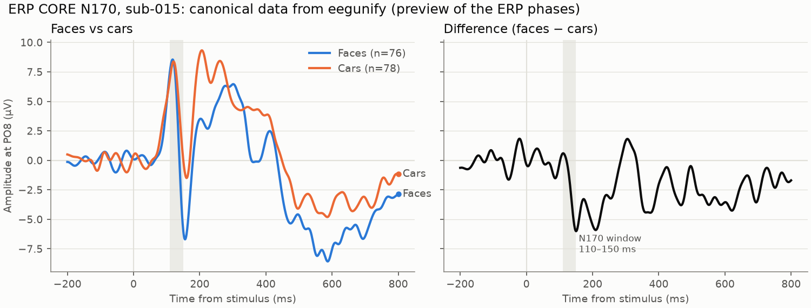

# eeg-erp-pipeline

[](https://github.com/StefanoGaliano/eeg-erp-pipeline/actions/workflows/ci.yml)
[](https://github.com/StefanoGaliano/eeg-erp-pipeline/actions/workflows/integration.yml)


One pipeline from **any raw EEG recording to ERPs**, focused on visual paradigms (VEP, P1/N1,
N170, P3).

EEG labs record with BioSemi, Brain Products, EGI, ANT, Neuroscan, g.tec, OpenBCI or LSL, and
every format encodes channels, units, references and triggers differently. **Phase 1,
`eegunify`, turns all of them into one canonical BIDS-EEG form.** Every later analysis step then
reads a single representation, whatever the hardware. Each conversion is validated and comes
with a QA report.



*ERP CORE N170 (sub-015), read from eegunify's canonical output: faces evoke a larger negativity
than cars at PO8 around 150 ms. The minimal ERP steps here are a preview of the later phases:
[`code/scripts/erp_preview.py`](code/scripts/erp_preview.py).*

## Why trust it

- **Checked against the dataset authors' own files.**
  - **ERP CORE N170:** all 640 event codes are identical to ERP CORE's own `events.tsv` and
    onsets agree within 0.05 ms. Golden-file tests run weekly in CI.
  - **MATLAB/EEGLAB:** the same data and events load in EEGLAB (verified in MATLAB).
- **Cross-format consistency.** The same recording exported in two formats gives identical data
  and events: ANT `.cnt` vs its BrainVision export, Curry 7/8 vs the BDF original.
- **Tested on data it has never seen.** 21 open datasets were run with automatically drafted
  configs. 19 convert, and the 2 refused have genuine defects in their files: one is scaled
  10⁶ too large, the other is an 11-byte broken upload. See the
  [validation results](docs/validation_results.md).
- **Refuses rather than guesses.**
  - Unit mix-ups (µV stored as V) are refused, with the fix suggested.
  - Neuroscan's ambiguous 16/32-bit samples are resolved by physiological plausibility, or the
    file is refused.
  - Dropped triggers in behavioural logs leave one trial unmatched instead of shifting the rest.
- **Engineering:**
  - CI on Linux, macOS and Windows with Python 3.11–3.13.
  - Strict typing (mypy) and ~180 tests, including exact synthetic round trips for every
    writable format.
  - Every bug found on real data has a regression test named after the dataset that showed it.

## Quick start

```bash
conda env create -f environment.yml && conda activate eegunify

eegunify fetch erpcore -s 015 --dest sourcedata/erpcore    # ~80 MB of ERP CORE N170
eegunify convert code/configs/erpcore_n170.yaml -s 015     # → rawdata/ (BIDS) + QA report
python code/scripts/erp_preview.py                          # the figure above
```

On your own data:

```bash
eegunify inspect sourcedata/study/sub-01/eeg/sub-01_task-faces_eeg.bdf   # what's in the file?
eegunify config init <that file> --out code/configs/study.yaml          # draft a config
eegunify convert code/configs/study.yaml                                # BIDS + QA for all subjects
eegunify app                                                            # the same, interactively
```

The app (Streamlit) has three steps:
1. **Inspect** a recording.
2. **Configure** the dataset: event codes → conditions, bad channels, reference, units and
   electrode positions, validated as you type.
3. **Convert + QA.**

Every choice is a config key, so the saved YAML reproduces the run from the command line.

For MATLAB users:
- `eegunify export <config> --to eeglab` writes `.set` files.
- `matlab/load_canonical.m` loads a canonical recording into EEGLAB or FieldTrip.

## What the canonical form guarantees

The full list is in [docs/canonical_contract.md](docs/canonical_contract.md). In short:
- **Data:** continuous, exactly as recorded, in µV.
- **Channels:** 10-05 names, with the original names kept.
- **Events:** `events.tsv` keeps the **original trigger codes** next to the condition names
  (`stimulus/face`).
- **Reference:** the online reference is recorded; data are never re-referenced.
- **Bad channels** are marked, not removed.
- **Provenance:** sha256 of every source file. Sources are never modified.

| Docs | |
|---|---|
| [formats.md](docs/formats.md) | supported formats, where events come from, how each is tested |
| [config_reference.md](docs/config_reference.md) | every config key (generated from the schema) |
| [canonical_contract.md](docs/canonical_contract.md) | what downstream stages can rely on |
| [validation_datasets.md](docs/validation_datasets.md) / [validation_results.md](docs/validation_results.md) | the 40-dataset real-world test bed and its results |
| [BLUEPRINT.md](docs/BLUEPRINT.md) | architecture, decisions, roadmap |

## Roadmap

- **Phase 1 (done):** unified ingestion, QA, interactive app (A1), MATLAB interop.
- **Next:** the ERP stages on the canonical data:
  - filtering, re-referencing, ICA;
  - epoching, averaging;
  - P1, N170 and P3 measurement in visual regions of interest;
  - an app page to choose components (A2).
- **Phase M:** the same ingestion natively in MATLAB, with outputs that match Python.

## Repository layout

| Folder | Contents |
|---|---|
| `src/eegunify/` | Python package (`readers/`, `events/`, `channels/`, `qa/`, `app/`) |
| `tests/` | unit, synthetic round-trip, real-data (`pytest -m realdata`) and MATLAB tests |
| `code/configs/` | dataset configs (ERP CORE N170, validation catalog) |
| `code/scripts/` | analysis scripts built on the canonical data |
| `matlab/` | `load_canonical.m` and its tests |
| `sourcedata/`, `rawdata/`, `derivatives/` | BIDS data folders (git-ignored) |

## License and citation

Code: MIT. Documentation: CC-BY-4.0. ERP CORE data: CC-BY-4.0 (Kappenman et al., 2021,
*NeuroImage* 225, 117465). See [CITATION.cff](CITATION.cff).
