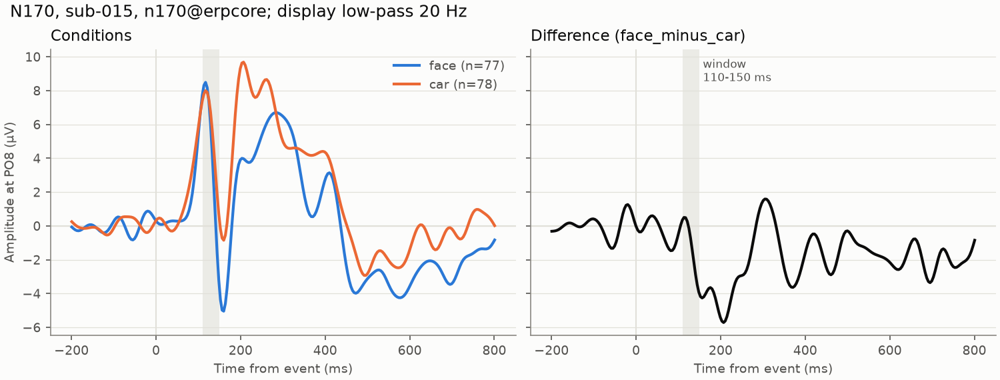
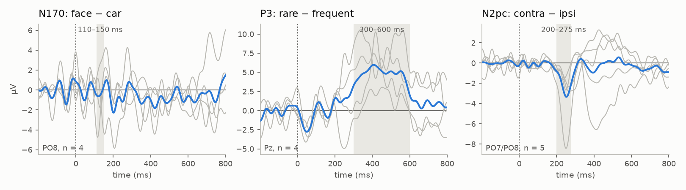
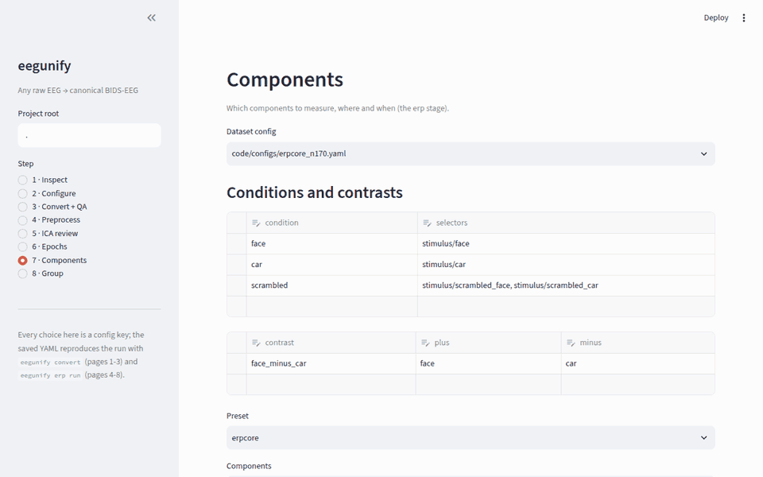

# eeg-erp-pipeline

[](https://github.com/StefanoGaliano/eeg-erp-pipeline/actions/workflows/ci.yml)
[](https://github.com/StefanoGaliano/eeg-erp-pipeline/actions/workflows/integration.yml)


One pipeline from **any raw EEG recording to ERPs**, focused on visual paradigms (VEP, P1/N1,
N170, P3).

EEG labs record with BioSemi, Brain Products, EGI, ANT, Neuroscan, g.tec, OpenBCI or LSL, and
every format encodes channels, units, references and triggers differently. **Phase 1,
`eegunify`, turns all of them into one canonical BIDS-EEG form.** Every later analysis step then
reads a single representation, whatever the hardware. Each conversion is validated and comes
with a QA report.



*ERP CORE N170 (sub-015) through the ERP stages with ERP CORE's recipe (256 Hz, 0.1 Hz
Butterworth high-pass, average reference, ICA with ICLabel, ERPLAB-style rejection): faces evoke
a larger negativity than cars at PO8. The figure is the erp stage's own output
([`code/scripts/erp_preview.py`](code/scripts/erp_preview.py) runs the pipeline and copies it).*

First `measures.tsv` (sub-015, N170 window 110–150 ms at PO8, from the component library's
`n170@erpcore` preset; 13 of 320 epochs rejected):

| wave | measure | value | trials |
|---|---|---|---|
| face − car | mean amplitude | −1.22 µV | 77 |
| face − car | 50 % area latency | 144.5 ms | 77 |
| face | mean amplitude | 4.42 µV | 77 |
| car | mean amplitude | 5.64 µV | 78 |

## ERP CORE reproduction

ERP CORE (Kappenman et al., 2021) publishes, per subject, the mean amplitude its own
EEGLAB/ERPLAB pipeline measured. The five subjects of its BIDS archive (sub-015..019) run
through eegunify, group stage included, with two recipes:

- **default**: our automatic pipeline (picard ICA + ICLabel, one rejection rule set for everyone);
- **`erpcore-exact`**: ERP CORE's own per-subject choices, read from their files (their ICA
  weights and removed components, interpolated channels, rejection thresholds).

Contrast mean amplitude, ours − ERP CORE, per subject ERP CORE included (µV):

| Component (window, ROI) | Recipe | 015 | 016 | 017 | 018 | 019 | Mean |
|---|---|---|---|---|---|---|---|
| N170 face − car (110–150 ms, PO8) | default | +0.10 | excl.¹ | **+0.68** | −0.24 | +0.44 | +0.25 |
| | exact | −0.44 | excl.¹ | +0.48 | +0.04 | +0.12 | +0.05 |
| P3 rare − frequent (300–600 ms, Pz) | default | +0.01 | **excl.²** | +0.28 | +0.35 | **−0.62** | +0.00 |
| | exact | +0.00 | −0.08 | −0.04 | +0.04 | −0.05 | −0.02 |
| N2pc contra − ipsi (200–275 ms, PO7/PO8) | default | +0.03 | +0.06 | −0.22 | +0.03 | **−1.34** | −0.29 |
| | exact | −0.09 | −0.11 | +0.10 | +0.05 | +0.15 | +0.02 |

Tolerance ±0.5 µV per subject and ±0.3 µV for the mean, with the sign equal to ERP CORE's
wherever their value is clearly away from zero. **With ERP CORE's own choices every compared
subject is within tolerance** (P3 within 0.08 µV, N2pc within 0.15 µV); the automatic recipe is
within tolerance for 10 of 13 subject-component pairs. Bold cells are the documented
deviations: they come from per-subject decisions (thresholds, ICA components), not from the
implementation. ¹ ERP CORE excluded N170 sub-016 too (2 correct face trials). ² Our single
100 µV threshold rejects 57 % of its P3 epochs; ERP CORE used 160 µV for this subject. Details,
latencies and parent waves: [validation_erp.md](docs/validation_erp.md).



*Grand-average difference waves (blue) and every included subject (grey), default recipe,
20 Hz low-pass for display; shaded: measurement window
([`code/scripts/erpcore_grand_average.py`](code/scripts/erpcore_grand_average.py)).*

**What five subjects can and cannot show.** They can show per-subject agreement with the
published values (the strongest test, independent of N), that the waves have the right shape
and that the pipeline is wired correctly. They cannot reproduce ERP CORE's 40-subject grand
mean, effect sizes or significance: with N = 4 the smallest possible one-tailed permutation p
is 1/16, and the group stage says so (`GROUP_UNDERPOWERED`). The N170 group effect is not
significant here, because sub-019's face − car difference is positive in ERP CORE's own data.

## Why trust it

- **Checked against the dataset authors' own files.**
  - **ERP CORE N170:** all 640 event codes are identical to ERP CORE's own `events.tsv` and
    onsets agree within 0.05 ms. Golden-file tests run weekly in CI.
  - **MATLAB/EEGLAB:** the same data and events load in EEGLAB (verified in MATLAB).
  - **ERPLAB:** on the same preprocessed data, ERPLAB 13.10 rejects the same epochs and measures
    the same mean amplitudes (|Δ| < 10⁻⁶ µV).
  - **ERP CORE's published measurements:** see the reproduction table above.
- **Cross-format consistency.** The same recording exported in two formats gives identical data
  and events: ANT `.cnt` vs its BrainVision export, Curry 7/8 vs the BDF original.
- **Tested on data it has never seen.** 21 open datasets were run with automatically drafted
  configs. 19 convert, and the 2 refused have genuine defects in their files: one is scaled
  10⁶ too large, the other is an 11-byte broken upload. See the
  [validation results](docs/validation_results.md).
- **Refuses rather than guesses.**
  - Unit mix-ups (µV stored as V) are refused, with the fix suggested.
  - Neuroscan's ambiguous 16/32-bit samples are resolved by physiological plausibility, or the
    file is refused.
  - Dropped triggers in behavioural logs leave one trial unmatched instead of shifting the rest.
- **Engineering:**
  - CI on Linux, macOS and Windows with Python 3.11–3.13.
  - Strict typing (mypy) and ~390 tests, including exact synthetic round trips for every
    writable format and synthetic ground truth for every ERP stage.
  - Every bug found on real data has a regression test named after the dataset that showed it.

## Quick start

```bash
conda env create -f environment.yml && conda activate eegunify

eegunify fetch erpcore -s 015 --dest sourcedata/erpcore    # ~80 MB of ERP CORE N170
eegunify convert code/configs/erpcore_n170.yaml -s 015     # → rawdata/ (BIDS) + QA report
eegunify erp run code/configs/erpcore_n170.yaml -s 015      # preproc → ica → epochs → erp
python code/scripts/erp_preview.py                          # the figure and table above
```

On your own data:

```bash
eegunify inspect sourcedata/study/sub-01/eeg/sub-01_task-faces_eeg.bdf   # what's in the file?
eegunify config init <that file> --out code/configs/study.yaml          # draft a config
eegunify convert code/configs/study.yaml                                # BIDS + QA for all subjects
eegunify app                                                            # the same, interactively
```

The app (Streamlit) has eight steps:
1. **Inspect** a recording.
2. **Configure** the dataset: event codes → conditions, bad channels, reference, units and
   electrode positions, validated as you type.
3. **Convert + QA.**
4. **Preprocess:** filter, bad channels and reference, with a before/after spectrum.
5. **ICA review:** the component decisions, with manual exclude/keep per subject.
6. **Epochs:** epoch sets and rejection rules, with what they removed.
7. **Components:** conditions, contrasts and components; windows and ROIs as overrides of the
   preset, next to the subject's ERPs and measures.
8. **Group:** grand averages, statistics and the comparison with published values.

Every choice is a config key, so the saved YAML reproduces the run from the command line
(`eegunify convert`, `eegunify erp run`).



*The Components page on ERP CORE N170: moving the window start from 110 to 130 ms shows the
override of the `n170@erpcore` preset, moves the shaded window in the subject's ERP, and is what
the saved YAML contains.*

For MATLAB users:
- `eegunify export <config> --to eeglab` writes `.set` files.
- `matlab/load_canonical.m` loads a canonical recording into EEGLAB or FieldTrip.
- `matlab/+eegunify/` redoes ingestion and an ERP-lite chain natively in MATLAB (EEGLAB,
  FieldTrip, ERPLAB) from the same config (`eegunify config dump --json --resolved`).

### Python ↔ MATLAB parity (ERP CORE N170, sub-015)

| Check | Tolerance | Result |
|---|---|---|
| Ingestion: `events.tsv`, `channels.tsv` (`.set`, BrainVision, BDF) | identical | identical |
| Ingestion: channel data | < 0.001 µV | passes |
| Filtered, re-referenced continuous EEG | < 0.1 µV | 0.015 µV |
| Rejected epochs (moving-window ptp, HEOG step) | identical sets | identical (50 of 160) |
| Condition ERPs, RMS per channel | < 0.05 µV | 0.0005 µV |
| N170 mean amplitude 110-150 ms, PO8 (face, car, difference) | < 0.05 µV | ≤ 0.004 µV |

The MATLAB tests need a MATLAB licence, so they run locally (`pytest -m realdata`), not in CI.

## What the canonical form guarantees

The full list is in [docs/canonical_contract.md](docs/canonical_contract.md). In short:
- **Data:** continuous, exactly as recorded, in µV.
- **Channels:** 10-05 names, with the original names kept.
- **Events:** `events.tsv` keeps the **original trigger codes** next to the condition names
  (`stimulus/face`).
- **Reference:** the online reference is recorded; data are never re-referenced.
- **Bad channels** are marked, not removed.
- **Provenance:** sha256 of every source file. Sources are never modified.

| Docs | |
|---|---|
| [formats.md](docs/formats.md) | supported formats, where events come from, how each is tested |
| [config_reference.md](docs/config_reference.md) | every config key (generated from the schema) |
| [canonical_contract.md](docs/canonical_contract.md) | what downstream stages can rely on |
| [validation_datasets.md](docs/validation_datasets.md) / [validation_results.md](docs/validation_results.md) | the 40-dataset real-world test bed and its results |
| [BLUEPRINT.md](docs/BLUEPRINT.md) | architecture, decisions, roadmap |

## Roadmap

- **Phase 1 (done, v0.1.0):** unified ingestion, QA, interactive app (A1), MATLAB interop.
- **Single-subject ERPs (done, v0.2.0):** preproc (filter, bad channels, re-reference), ICA with
  ICLabel and an EOG vote, epochs with ERPLAB-style rejection, averages, difference waves and
  component measures (mean amplitude, peak, fractional-area latency) from a component library.
  Every stage is cached and writes QA. See [BLUEPRINT_PHASES.md](docs/BLUEPRINT_PHASES.md) and
  [validation_erp.md](docs/validation_erp.md).
- **Group statistics and the ERP CORE reproduction (done, v0.3.0):** group stage (grand
  averages, paired tests and effect sizes, cluster permutation, comparison with published
  values), lateralized contrasts (N2pc), N170/P3/N2pc configs, the `erpcore-exact` recipe and
  the ERPLAB cross-check.
- **App pages for the ERP stages (done, v0.4.0):** Preprocess, ICA review, Epochs, Components
  and Group in `eegunify app`.
- **Phase M, MATLAB parity (done, v0.5.0):** ingestion for `.set`, BrainVision and BDF (M1) and the
  ERP-lite N170 chain (M2) natively in MATLAB, matching Python (table above).
- **VEP presets (done, v0.6.0):** ISCEV pattern-reversal P100/N75/N135 at Oz, measured against Fz
  whatever the dataset's reference (component-level reference). Validated on synthetic data
  (P100 latency within 2 ms) and run on five infants of the GABA pattern-reversal VEP
  (Zenodo 5172962, `code/configs/gaba_vep.yaml`); results in docs/validation_erp.md.
- **40-subject N170 (done, v0.7.0, M-E6b):** all 40 ERP CORE N170 subjects. Face − car at PO8:
  −3.31 µV vs ERP CORE's −3.37 µV (d_z −1.22 vs −1.24, 37 subjects) with ERP CORE's own
  per-subject parameters (`erpcore-exact`), −3.45 vs −3.49 µV (36 subjects) with the default
  recipe. Details in docs/validation_erp.md.
- **Next:** BCI / real-time work (docs/BLUEPRINT_PHASES.md §13) once motor-restoration work starts.

## Repository layout

| Folder | Contents |
|---|---|
| `src/eegunify/` | Python package (`readers/`, `events/`, `channels/`, `qa/`, `app/`, `erp/`) |
| `tests/` | unit, synthetic round-trip, real-data (`pytest -m realdata`) and MATLAB tests |
| `code/configs/` | dataset configs (ERP CORE N170, P3, N2pc; validation catalog) |
| `code/scripts/` | analysis scripts built on the canonical data |
| `matlab/` | `+eegunify` package (Phase M), `load_canonical.m`, the ERPLAB cross-check, and their tests |
| `sourcedata/`, `rawdata/`, `derivatives/` | BIDS data folders (git-ignored) |

## License and citation

Code: MIT. Documentation: CC-BY-4.0. ERP CORE data: CC-BY-4.0 (Kappenman et al., 2021,
*NeuroImage* 225, 117465). See [CITATION.cff](CITATION.cff).
